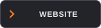
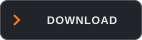
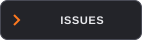

<p align="center">
  
</p>

<p align="center">
  <a href="https://anuness.dev/pt/projects/agent-workbench"></a>
  <a href="https://github.com/ItsAnunesS/agent-workbench/releases"></a>
  <a href="https://github.com/ItsAnunesS/agent-workbench/raw/refs/heads/release/assets/branding/downloads/agent-workbench-brand-kit-v1-en.zip"></a>
  <a href="https://github.com/ItsAnunesS/agent-workbench/issues"></a>
  <a href="CONTRIBUTING.md"></a>
</p>

<p align="center">
  <a href="https://github.com/ItsAnunesS/agent-workbench/actions/workflows/build.yml?query=branch%3Arelease"></a>
  <a href="https://github.com/ItsAnunesS/agent-workbench/blob/release/package.json"></a>
</p>

<p align="center">
  <a href="README.md"></a>
  <a href="docs/README.pt-BR.md"></a>
</p>

Agent Workbench is a desktop app for keeping personal and work AI sessions separate. Each environment owns its OpenAI account, projects, conversations and instructions. Chat is for discussion; Worker runs coding tasks against one project folder.

Built with **Tauri, React, TypeScript and Rust**. Linux AppImage is the current distribution target. Windows and macOS icons are configured; native packages on those systems are not validated yet.

## Contents

- [Features](#features)
- [Install and use](#install-and-use)
- [Development](#development)
- [Branches and releases](#branches-and-releases)
- [Security](#security)
- [License and brand](#license-and-brand)
- [Languages](#languages)

## Features

- Separate environments for personal work, clients or teams, with one OpenAI account per environment.
- Independent Chat and Worker histories. Context crosses modes only through an explicit handoff.
- Streaming Chat responses, model selection and cancellation using an eligible ChatGPT subscription. Send messages through the composer to request responses. Rename conversations and tasks using the pencil beside their title or **Rename** in the sidebar action menu. Custom names survive the first message and app restarts.
- Codex Worker with inline command activity, public progress summaries, file diffs, persistent elapsed time, approvals and cancellation.
- Expandable projects containing their chats/tasks, with unassigned conversations listed separately. Right-click or use the action menu to rename, pin, duplicate, move, archive, restore or delete items.
- One Docker container per task. Only the selected project folder is mounted; commands have no external network access. OpenAI credentials remain in the host app.
- Local SQLite storage, environment instructions and project memory.
- Dark, light and system themes; integrated window controls; native desktop icons.
- English by default, with a persistent English/Portuguese language selector in Global settings. Interface text, native API errors, Worker status messages and the login callback page follow the selected language.

Worker offers **Ask for approval** (the default) and **Approve for me** in the composer. Automatic review uses the selected model to approve only actions assessed as low risk. Potentially unsafe or inconclusive actions, and review failures, fall back to manual approval. Both modes keep the same Docker, project-folder and network restrictions. The setting applies to the next task and is saved on this device.

Archiving preserves content. Deleting a conversation also removes its task records; deleting a project keeps its conversations in General and never deletes local project files. Active work cannot be archived, moved or deleted from the action menu.

Worker edits the project folder directly. Cancelling a task does not revert edits. The initial Worker image includes Node.js, Python, Git and build essentials; other toolchains are not installed automatically.

## Install and use

1. Download the latest AppImage from [Releases](https://github.com/ItsAnunesS/agent-workbench/releases). Builds from individual commits are available under [Actions](https://github.com/ItsAnunesS/agent-workbench/actions/workflows/build.yml).
2. Make it executable and run it:

   ```sh
   chmod +x "Agent-Workbench_<version>_amd64.AppImage"
   "./Agent-Workbench_<version>_amd64.AppImage"
   ```

3. Choose an environment, then open **Workspace settings** using the OpenAI card at the bottom of its sidebar to connect its account.
4. To use Worker, start Docker, prepare the runtime in **Global settings**, then select a project folder and a model.

Use **Usage** above the OpenAI sidebar card to see locally recorded input, output, cached input and reasoning tokens, daily activity and recent responses. Counts come from actual OpenAI response usage for Chat, Worker and automatic approval reviews. Cached input and reasoning are subsets, not additional charges. The ledger persists on this device and is isolated by environment and account registration; it stores usage metadata, never prompts or credentials. Older requests are not imported, interrupted requests may lack usage, and missing counts are shown as unknown. Disconnecting an account hides its recorded usage. A new account registration starts a separate history.

The current Sign in with ChatGPT connection does not expose remaining plan allowance, reset times or credits through a documented endpoint. **Manage usage** opens the [official ChatGPT usage page](https://chatgpt.com/settings/usage). Local token totals do not measure remaining allowance, other apps or billing.

Subscription access depends on account eligibility and the models granted by OpenAI. A ChatGPT plan does not imply unrestricted access. The app keeps its own conversation history; it does not import the official ChatGPT or Codex history.

On Linux, the AppImage registers its launcher and logo in the current user's application menu. If the AppImage moves, open it once from its new location. **Global settings > Repair integration** refreshes the launcher.

The bottom icon in the environment rail opens **Global settings** for language, appearance, desktop integration, the shared Worker runtime and app information. Expand **Global AGENTS.md and Git conventions** to edit shared instructions and commit, pull request and branch naming conventions, then click **Save global instructions**. These settings persist across workspaces and are included in new Chat requests and Worker task context. They guide generated work without automatically executing Git actions. The global AGENTS.md editor stores app instructions without modifying existing AGENTS.md files on your computer or in projects.

The logo at the top of the environment rail is rendered in 3D with Three.js. Hover over it to tilt the logo and move its eyes with the pointer. Its eyes blink occasionally, while tilt settles when the pointer leaves. The robot also blinks in Chat, Worker, project welcome screens and message avatars. Blinking respects reduced-motion preferences, and the 3D renderer pauses it in hidden windows and falls back to the animated SVG when WebGL is unavailable. Clicking it still opens global settings.

The OpenAI card opens **Workspace settings** for the selected environment's account and instructions. With a project selected, this panel also shows its folder and memory, with actions to edit them. Workspace instructions and project memory remain specific to their environment and project, and combine with the global instructions.

When a project folder is linked, its root `AGENTS.md` is recognized automatically as project-specific workspace instructions for Chat and Worker. If only `agents.md` exists, that name is accepted; `AGENTS.md` takes precedence when both exist. **Workspace settings > Project settings > Project AGENTS.md** shows the detected source and a read-only preview, with refresh and focus reload. The file is read again for every new Chat request or Worker run, so external edits and removal take effect without importing stale copies into environment settings. Project instructions override conflicting global/workspace preferences, while manual settings and project memory are preserved. Standalone conversations and other projects do not inherit this file. Only regular UTF-8 files up to 128 KiB are accepted; symlinks, null bytes and invalid files produce a visible error. Chat receives this instruction file but cannot browse other local files.

The right panel opens on a tools dashboard with cards and recently visited pages. Its tabs provide **Files**, **Changes**, **Terminal**, **Browser** and **Context**. Expand the panel for more room, or use the arrow keys to switch between its tabs.

- **Files** explores the selected project folder and previews UTF-8 text with line numbers. Previews are read-only and limited to 500 KB. Folders load on expansion, with up to 2,000 entries each; symbolic links are disabled in the tree and paths outside the project are rejected.
- **Changes** shows file diffs reported by the AI for the selected Worker task, with an execution selector. Saved Worker event previews may be truncated; this is not a full Git working-tree diff.
- **Terminal** is a real local PTY with xterm.js. Set its shell executable and arguments in **Global settings > Terminal settings**. In **Workspace settings > Terminal settings**, clear **Use global terminal settings** to override them for that environment. Arguments are passed separately, one per line. Changes apply to new terminals. The terminal starts in the selected project folder, or in your home directory for a standalone conversation. Its session stays open when switching tool tabs and closes when changing scope, hiding the tools panel or exiting the app. Commands are user-controlled and run on the host; the AI Worker retains its Docker boundary.
- **Browser** is available on Linux and Windows and uses a native child webview (WebKit on Linux) with address entry, back, forward and reload controls, including local development URLs such as `localhost:3000`. Cookies, cache and site storage use a separate persistent profile for each project. Conversations and tasks without a project each get their own profile. Recent pages are scoped the same way. The view hides when another tool or a settings dialog is open, and remote pages cannot invoke native app commands. Downloads and popup windows are currently blocked.

Desktop tools require the native app. Reading project files in the panel does not automatically send them to the AI.

Choose **Global settings > Language** to change the app language. Existing environment names, conversations, project memory, model responses, code and command output are preserved as written. New installations create the default environments as **Personal** and **Work**.

The Linux x86_64 AppImage checks the latest stable GitHub Release on startup and every six hours. **Global settings > App updates** lets you disable automatic checks, check manually and choose **Download and install**. The app validates the release asset size, AppImage header and GitHub SHA-256 digest before replacing its AppImage atomically at the same path. Failed downloads leave the installed file untouched; updates require a writable application folder. Existing chats and Worker tasks keep running. Close and reopen the app when finished to use the new version. Older versions without the built-in updater need one manual upgrade.

New AppImages include the standard update source for the latest stable GitHub Release. Import the AppImage into Gear Lever or another compatible manager to detect and install updates without entering a repository URL. Update checks and automatic installation depend on the manager's settings. Older AppImages without this metadata need a one-time manual replacement. AppImageUpdate is also supported through the `.zsync` file published alongside each release; download the `.AppImage` to run the app.

## Development

Use Docker for a consistent Linux build environment:

```sh
git clone git@github.com:ItsAnunesS/agent-workbench.git
cd agent-workbench
git switch dev
bash scripts/build-appimage.sh
```

The script builds the container, installs locked dependencies, checks types, runs tests and generates the AppImage, its `.zsync` update index and `SHA256SUMS` in `artifacts/`. Packaging verifies the embedded update source and checks that the index matches the AppImage. No API key is required to build or run unit tests. Rust tests reuse release-profile dependencies with an unoptimized application test harness and debug/overflow checks enabled; production optimization is unchanged, and the TypeScript build checks types once. CI caches the Docker builder, npm downloads and Cargo release compilation. Release publication installs npm dependencies once and retains every test suite. Timed log groups separate tests from compilation/packaging; the first cold-cache build is still slower.

For UI work, use Node.js 22.12 or later:

```sh
npm ci
npm run dev
```

The browser preview does not authenticate accounts or execute Workers. Native development additionally needs Rust and the [Tauri prerequisites](https://v2.tauri.app/start/prerequisites/). See [CONTRIBUTING.md](CONTRIBUTING.md) for checks and commit conventions.

## Branches and releases

| Branch    | Purpose                                                |
| --------- | ------------------------------------------------------ |
| `dev`     | Normal development and integration.                    |
| `release` | Stable/default branch and source for published builds. |

Work directly on `dev` or use a short-lived branch. Merge tested work into `release`. Small fixes may go directly to `release`; bring them back into `dev` afterwards. Pull requests are useful, not mandatory for the maintainer.

Pushes to `dev` and PRs targeting `dev` or `release` run the build workflow. Pushes to `release` run **Publish release**, which performs the checks and produces the versioned AppImage once, without a second full build. `semantic-release` analyzes commits since the latest reachable version tag: `feat` increments the minor version, breaking changes (`!` or a `BREAKING CHANGE:` footer) increment the major version, and other commits, including documentation and maintenance, increment the patch version. A push containing multiple commits uses the highest applicable increment and publishes one version.

The publisher synchronizes `package.json`, `package-lock.json`, the Cargo package and lockfile, Tauri configuration and `CHANGELOG.md`, combining handwritten notes with generated commit notes. It builds and tests before atomically pushing a version commit and immutable `vX.Y.Z` tag. The GitHub Release becomes public only after its AppImage, `.zsync` index and checksums are uploaded. Automation's own `chore(release): v...` commits do not create another release. No npm package is published and no personal access token is required.

**Actions > Publish release > Run workflow** remains available for `auto`, explicit `patch`/`minor`/`major` bumps, or `current` to recover a tagged version after an interrupted publication. Published assets and tags are not overwritten. If the branch advances during a build, the verified snapshot is still published under its immutable tag. Version metadata is synchronized into the latest branch head, preserving newer source code, dependencies and unreleased notes. Concurrent pushes are retried without force-pushing. The queued run then publishes the newer changes; GitHub may coalesce pending pushes into the latest queued run. Merge the generated version commit back into `dev` before starting further work there.

Commits and PR titles use [Conventional Commits](https://www.conventionalcommits.org/en/v1.0.0/). Example: `fix(linux): match the window ID to its desktop launcher`. See [CHANGELOG.md](CHANGELOG.md) for version history and [CONTRIBUTING.md](CONTRIBUTING.md#publishing) for the release procedure.

## Security

Report vulnerabilities privately using [SECURITY.md](SECURITY.md). Do not put tokens, credentials, private prompts or company files in issues.

The Worker isolation boundary is Docker, not a Git worktree. The selected folder is writable. Review approvals and diffs, and keep credentials outside project folders. See the [security policy](SECURITY.md) for scope and reporting.

## License and brand

Source code is licensed under [MIT](LICENSE). This license applies to code, not the reserved brand assets described below. **The name, robot logo, icons, original artwork and visual identity are reserved to André Nunes** and are not covered by any permission to reuse the code. See [Brand and artwork license](LICENSE-BRAND.md).

[Download the brand kit in English (ZIP)](https://github.com/ItsAnunesS/agent-workbench/raw/refs/heads/release/assets/branding/downloads/agent-workbench-brand-kit-v1-en.zip), including the PDF guide, logos, icons, colors and fonts. Download is provided for official project reference and does not authorize reuse, republication or redistribution of the brand assets. Fonts and other third-party materials retain their own licenses; see [THIRD_PARTY_NOTICES.md](THIRD_PARTY_NOTICES.md).

Project: [anuness.dev/pt/projects/agent-workbench](https://anuness.dev/pt/projects/agent-workbench).

## Languages

<p align="center">
  <a href="README.md"></a>
  <a href="docs/README.pt-BR.md"></a>
</p>
