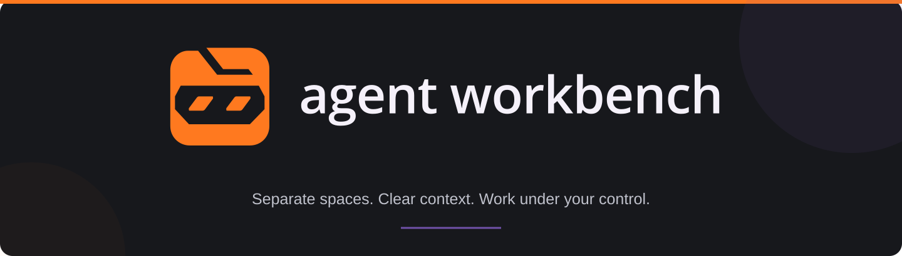
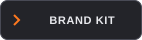
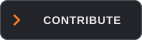
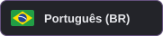

<p align="center">
  
</p>

<p align="center">
  <a href="https://anuness.dev/pt/projects/agent-workbench"></a>
  <a href="https://github.com/ItsAnunesS/agent-workbench/releases"></a>
  <a href="https://github.com/ItsAnunesS/agent-workbench/raw/refs/heads/release/assets/branding/downloads/agent-workbench-brand-kit-v1-en.zip"></a>
  <a href="https://github.com/ItsAnunesS/agent-workbench/issues"></a>
  <a href="CONTRIBUTING.md"></a>
</p>

<p align="center">
  <a href="https://github.com/ItsAnunesS/agent-workbench/actions/workflows/build.yml?query=branch%3Arelease"></a>
  <a href="https://github.com/ItsAnunesS/agent-workbench/blob/release/package.json"></a>
</p>

<p align="center">
  <a href="README.md"></a>
  <a href="docs/README.pt-BR.md"></a>
</p>

Agent Workbench is a desktop app for keeping personal and work AI sessions separate. Each environment owns its OpenAI account, projects, conversations and instructions. Chat is for discussion; Worker runs coding tasks against one project folder.

Built with **Tauri, React, TypeScript and Rust**. Linux AppImage is the current distribution target. Windows and macOS icons are configured; native packages on those systems are not validated yet.

## Contents

- [Features](#features)
- [Install and use](#install-and-use)
- [Development](#development)
- [Branches and releases](#branches-and-releases)
- [Security](#security)
- [License and brand](#license-and-brand)
- [Languages](#languages)

## Features

- Separate environments for personal work, clients or teams, with one OpenAI account per environment.
- Independent Chat and Worker histories. Context crosses modes only through an explicit handoff.
- Streaming Chat responses, model selection and cancellation using an eligible ChatGPT subscription.
- Codex Worker with inline command activity, public progress summaries, file diffs, persistent elapsed time, approvals and cancellation.
- Expandable projects containing their chats/tasks, with unassigned conversations listed separately. Right-click or use the action menu to rename, pin, duplicate, move, archive, restore or delete items.
- One Docker container per task. Only the selected project folder is mounted; commands have no external network access. OpenAI credentials remain in the host app.
- Local SQLite storage, environment instructions and project memory.
- Dark, light and system themes; integrated window controls; native desktop icons.
- English by default, with a persistent English/Portuguese language selector in Settings. Interface text, native API errors, Worker status messages and the login callback page follow the selected language.

Worker offers **Ask for approval** (the default) and **Approve for me** in the composer. Automatic review uses the selected model to approve only actions assessed as low risk. Potentially unsafe or inconclusive actions, and review failures, fall back to manual approval. Both modes keep the same Docker, project-folder and network restrictions. The setting applies to the next task and is saved on this device.

Archiving preserves content. Deleting a conversation also removes its task records; deleting a project keeps its conversations in General and never deletes local project files. Active work cannot be archived, moved or deleted from the action menu.

Worker edits the project folder directly. Cancelling a task does not revert edits. The initial Worker image includes Node.js, Python, Git and build essentials; other toolchains are not installed automatically.

## Install and use

1. Download the latest AppImage from [Releases](https://github.com/ItsAnunesS/agent-workbench/releases). Builds from individual commits are available under [Actions](https://github.com/ItsAnunesS/agent-workbench/actions/workflows/build.yml).
2. Make it executable and run it:

   ```sh
   chmod +x "Agent-Workbench_<version>_amd64.AppImage"
   "./Agent-Workbench_<version>_amd64.AppImage"
   ```

3. Open **Settings**, choose an environment and connect its OpenAI account.
4. To use Worker, start Docker, prepare the runtime in Settings, then select a project folder and a model.

Subscription access depends on account eligibility and the models granted by OpenAI. A ChatGPT plan does not imply unrestricted access. The app keeps its own conversation history; it does not import the official ChatGPT or Codex history.

On Linux, the AppImage registers its launcher and logo in the current user's application menu. If the AppImage moves, open it once from its new location. **Settings > Repair integration** refreshes the launcher.

Choose **Settings > Language** to change the app language. Existing environment names, conversations, project memory, model responses, code and command output are preserved as written. New installations create the default environments as **Personal** and **Work**.

New AppImages include the standard update source for the latest stable GitHub Release. Import the AppImage into Gear Lever or another compatible manager to detect and install updates without entering a repository URL. Update checks and automatic installation depend on the manager's settings. Older AppImages without this metadata need a one-time manual replacement. AppImageUpdate is also supported through the `.zsync` file published alongside each release; download the `.AppImage` to run the app.

## Development

Use Docker for a consistent Linux build environment:

```sh
git clone git@github.com:ItsAnunesS/agent-workbench.git
cd agent-workbench
git switch dev
bash scripts/build-appimage.sh
```

The script builds the container, installs locked dependencies, checks types, runs tests and generates the AppImage, its `.zsync` update index and `SHA256SUMS` in `artifacts/`. Packaging verifies the embedded update source and checks that the index matches the AppImage. No API key is required to build or run unit tests.

For UI work, use Node.js 22.12 or later:

```sh
npm ci
npm run dev
```

The browser preview does not authenticate accounts or execute Workers. Native development additionally needs Rust and the [Tauri prerequisites](https://v2.tauri.app/start/prerequisites/). See [CONTRIBUTING.md](CONTRIBUTING.md) for checks and commit conventions.

## Branches and releases

| Branch    | Purpose                                                |
| --------- | ------------------------------------------------------ |
| `dev`     | Normal development and integration.                    |
| `release` | Stable/default branch and source for published builds. |

Work directly on `dev` or use a short-lived branch. Merge tested work into `release`. Small fixes may go directly to `release`; bring them back into `dev` afterwards. Pull requests are useful, not mandatory for the maintainer.

Every push to `dev` or `release`, and every PR targeting them, runs the build workflow. Successful `release` builds are available as commit-specific artifacts. To publish a version, run **Actions > Publish release** on `release` and choose `current`, `patch`, `minor` or `major`. The workflow updates version files, builds and tests, pushes an immutable `vX.Y.Z` tag, and attaches the AppImage, `.zsync` index and checksum to a GitHub Release.

Commits and PR titles use [Conventional Commits](https://www.conventionalcommits.org/en/v1.0.0/). Example: `fix(linux): match the window ID to its desktop launcher`. See [CHANGELOG.md](CHANGELOG.md) for version history and [CONTRIBUTING.md](CONTRIBUTING.md#publishing) for the release procedure.

## Security

Report vulnerabilities privately using [SECURITY.md](SECURITY.md). Do not put tokens, credentials, private prompts or company files in issues.

The Worker isolation boundary is Docker, not a Git worktree. The selected folder is writable. Review approvals and diffs, and keep credentials outside project folders. See the [security policy](SECURITY.md) for scope and reporting.

## License and brand

Source code is licensed under [MIT](LICENSE). This license applies to code, not the reserved brand assets described below. **The name, robot logo, icons, original artwork and visual identity are reserved to André Nunes** and are not covered by any permission to reuse the code. See [Brand and artwork license](LICENSE-BRAND.md).

[Download the brand kit in English (ZIP)](https://github.com/ItsAnunesS/agent-workbench/raw/refs/heads/release/assets/branding/downloads/agent-workbench-brand-kit-v1-en.zip), including the PDF guide, logos, icons, colors and fonts. Download is provided for official project reference and does not authorize reuse, republication or redistribution of the brand assets. Fonts and other third-party materials retain their own licenses; see [THIRD_PARTY_NOTICES.md](THIRD_PARTY_NOTICES.md).

Project: [anuness.dev/pt/projects/agent-workbench](https://anuness.dev/pt/projects/agent-workbench).

## Languages

<p align="center">
  <a href="README.md"></a>
  <a href="docs/README.pt-BR.md"></a>
</p>
