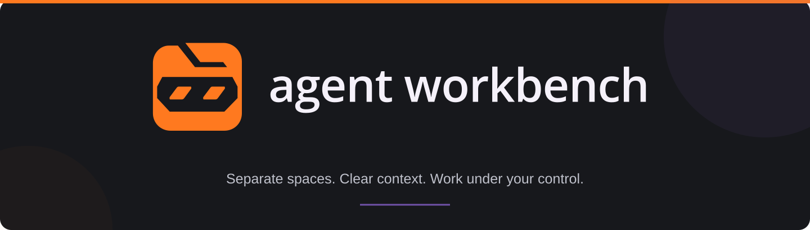
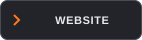
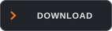
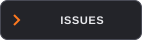

<p align="center">
  
</p>

<p align="center">
  <a href="https://anuness.dev/pt/projects/agent-workbench"></a>
  <a href="https://github.com/ItsAnunesS/agent-workbench/releases"></a>
  <a href="../assets/branding/brand-kit-v1"></a>
  <a href="https://github.com/ItsAnunesS/agent-workbench/issues"></a>
  <a href="../CONTRIBUTING.md"></a>
</p>

<p align="center"><a href="../README.md">English</a> · <a href="README.pt-BR.md">Português (Brasil)</a></p>

Agent Workbench é um app desktop para separar sessões pessoais e profissionais de IA. Cada ambiente tem sua própria conta OpenAI, projetos, conversas e instruções. O Chat serve para conversar; o Worker executa tarefas de código em uma pasta de projeto.

Feito com **Tauri, React, TypeScript e Rust**. A distribuição atual é o AppImage para Linux. Os ícones de Windows e macOS estão configurados, mas os pacotes nativos desses sistemas ainda não foram validados.

## Sumário

- [Funcionalidades](#funcionalidades)
- [Instalação e uso](#instalação-e-uso)
- [Desenvolvimento](#desenvolvimento)
- [Branches e versões](#branches-e-versões)
- [Segurança](#segurança)
- [Licença e marca](#licença-e-marca)
- [Idiomas](#idiomas)

## Funcionalidades

- Ambientes separados por contexto, com uma conta OpenAI por ambiente.
- Históricos independentes de Chat e Worker. O contexto só passa de um modo para outro por uma ação explícita.
- Chat com streaming, escolha de modelo e cancelamento, usando uma assinatura ChatGPT elegível.
- Codex Worker com atividade dos comandos, diffs, aprovações pontuais e cancelamento.
- Um container Docker por tarefa. Apenas a pasta escolhida fica montada; os comandos não têm acesso externo à rede. As credenciais OpenAI permanecem no app, fora do container.
- Dados locais em SQLite, instruções por ambiente e memória por projeto.
- Temas escuro, claro e do sistema, controles de janela integrados e ícones nativos.

O Worker altera a pasta do projeto diretamente. Cancelar uma tarefa não desfaz alterações. A imagem inicial inclui Node.js, Python, Git e ferramentas básicas de compilação; outros toolchains não são instalados automaticamente.

## Instalação e uso

1. Baixe o AppImage em [Releases](https://github.com/ItsAnunesS/agent-workbench/releases). Builds por commit ficam em [Actions](https://github.com/ItsAnunesS/agent-workbench/actions/workflows/build.yml).
2. Dê permissão de execução e abra o arquivo:

   ```sh
   chmod +x "Agent Workbench_<versão>_amd64.AppImage"
   "./Agent Workbench_<versão>_amd64.AppImage"
   ```

3. Nas definições do app, escolha um ambiente e conecte sua conta OpenAI.
4. Para usar o Worker, inicie o Docker, prepare o runtime nas definições e selecione a pasta do projeto e o modelo.

O acesso pela assinatura depende da elegibilidade da conta e dos modelos liberados pela OpenAI. O plano ChatGPT não garante acesso ilimitado. O histórico pertence ao app; conversas oficiais do ChatGPT e do Codex não são importadas.

No Linux, o AppImage registra o atalho e o logo no menu de aplicativos do usuário. Se mover o arquivo, abra-o uma vez no novo local. A opção **Reparar integração**, nas definições, atualiza o atalho.

## Desenvolvimento

Use Docker para manter o ambiente de build consistente:

```sh
git clone git@github.com:ItsAnunesS/agent-workbench.git
cd agent-workbench
git switch dev
bash scripts/build-appimage.sh
```

O script monta o ambiente, instala as dependências dos lockfiles, verifica os tipos, executa os testes e gera o AppImage e `SHA256SUMS` em `artifacts/`. O build e os testes unitários não exigem chave de API.

Para trabalhar na interface, use Node.js 22.12 ou superior:

```sh
npm ci
npm run dev
```

A prévia no navegador não autentica contas nem executa Workers. O desenvolvimento nativo também exige Rust e os [pré-requisitos do Tauri](https://v2.tauri.app/start/prerequisites/). As verificações e convenções ficam em [CONTRIBUTING.md](../CONTRIBUTING.md).

## Branches e versões

| Branch    | Uso                                                                    |
| --------- | ---------------------------------------------------------------------- |
| `dev`     | Desenvolvimento e integração do trabalho corrente.                     |
| `release` | Branch estável, padrão do repositório e origem das versões publicadas. |

Trabalhe direto em `dev` ou use uma branch curta. Leve o trabalho testado para `release`. Correções pequenas podem entrar direto em `release`; depois, sincronize `dev`. PRs são úteis, mas não obrigatórias para o mantenedor.

Cada push para `dev` ou `release`, e cada PR direcionada a elas, executa o build. Builds bem-sucedidos de `release` ficam disponíveis como artefatos por commit. Para publicar uma versão, execute **Actions > Publish release**, em `release`, e escolha `current`, `patch`, `minor` ou `major`. O workflow atualiza as versões, compila, testa, cria a tag imutável `vX.Y.Z` e publica o AppImage e seu checksum em uma GitHub Release.

Commits e títulos de PR seguem [Conventional Commits](https://www.conventionalcommits.org/en/v1.0.0/). Exemplo: `fix(linux): match the window ID to its desktop launcher`. Consulte o [CHANGELOG.md](../CHANGELOG.md) e o [procedimento de publicação](../CONTRIBUTING.md#publishing).

## Segurança

Reporte vulnerabilidades de forma privada, seguindo [SECURITY.md](../SECURITY.md). Não publique tokens, credenciais, prompts privados ou arquivos de empresas nas issues.

O isolamento do Worker é feito pelo Docker, não por um worktree Git. A pasta selecionada tem acesso de escrita. Revise aprovações e diffs e mantenha credenciais fora das pastas dos projetos.

## Licença e marca

O código-fonte usa a licença [MIT](../LICENSE). Essa licença se aplica ao código, não aos materiais de marca reservados descritos abaixo. **O nome, o robô, os logos, os ícones, as imagens originais e a identidade visual são reservados a André Nunes.** A permissão de uso do código não concede direitos sobre esses materiais. Veja a [licença de marca e imagens](../assets/branding/LICENSE).

O [kit de marca](../assets/branding/brand-kit-v1) é uma referência oficial do projeto. O acesso não autoriza reutilização, extração ou redistribuição dos arquivos. Fontes e materiais de terceiros mantêm suas próprias licenças; consulte [THIRD_PARTY_NOTICES.md](../THIRD_PARTY_NOTICES.md).

Projeto: [anuness.dev/pt/projects/agent-workbench](https://anuness.dev/pt/projects/agent-workbench).

## Idiomas

[English](../README.md) · [Português (Brasil)](REA
