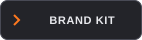
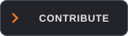

<p align="center">
  
</p>

<p align="center">
  <a href="https://anuness.dev/pt/projects/agent-workbench"></a>
  <a href="https://github.com/ItsAnunesS/agent-workbench/releases"></a>
  <a href="https://github.com/ItsAnunesS/agent-workbench/raw/refs/heads/release/assets/branding/downloads/agent-workbench-brand-kit-v1-pt-BR.zip"></a>
  <a href="https://github.com/ItsAnunesS/agent-workbench/issues"></a>
  <a href="../CONTRIBUTING.md"></a>
</p>

<p align="center">
  <a href="https://github.com/ItsAnunesS/agent-workbench/actions/workflows/build.yml?query=branch%3Arelease"></a>
  <a href="https://github.com/ItsAnunesS/agent-workbench/blob/release/package.json"></a>
</p>

<p align="center">
  <a href="../README.md"></a>
  <a href="README.pt-BR.md"></a>
</p>

Agent Workbench é um app desktop para separar sessões pessoais e profissionais de IA. Cada ambiente tem sua própria conta OpenAI, projetos, conversas e instruções. O Chat serve para conversar; o Worker executa tarefas de código em uma pasta de projeto.

Feito com **Tauri, React, TypeScript e Rust**. A distribuição atual é o AppImage para Linux. Os ícones de Windows e macOS estão configurados, mas os pacotes nativos desses sistemas ainda não foram validados.

## Sumário

- [Funcionalidades](#funcionalidades)
- [Instalação e uso](#instalação-e-uso)
- [Desenvolvimento](#desenvolvimento)
- [Branches e versões](#branches-e-versões)
- [Segurança](#segurança)
- [Licença e marca](#licença-e-marca)
- [Idiomas](#idiomas)

## Funcionalidades

- Ambientes separados por contexto, com uma conta OpenAI por ambiente.
- Históricos independentes de Chat e Worker. O contexto só passa de um modo para outro por uma ação explícita.
- Chat com streaming, escolha de modelo e cancelamento, usando uma assinatura ChatGPT elegível. Envie mensagens pelo campo de composição para solicitar respostas. Renomeie conversas e tarefas pelo lápis ao lado do título ou pela opção **Renomear** no menu da barra lateral. Os nomes escolhidos são mantidos após a primeira mensagem e ao reabrir o app.
- Codex Worker com atividade dos comandos junto da conversa, resumos públicos de progresso, diffs, tempo de execução persistente, aprovações e cancelamento.
- Projetos expansíveis com suas conversas/tarefas, separados das conversas sem projeto. Use o botão direito ou o menu de ações para renomear, fixar, duplicar, mover, arquivar, restaurar ou remover itens.
- Um container Docker por tarefa. Apenas a pasta escolhida fica montada; os comandos não têm acesso externo à rede. As credenciais OpenAI permanecem no app, fora do container.
- Dados locais em SQLite, instruções por ambiente e memória por projeto.
- Temas escuro, claro e do sistema, controles de janela integrados e ícones nativos.
- Inglês por padrão, com seleção persistente entre inglês e português nas definições. Os textos da interface, erros das APIs nativas, estados do Worker e a página de retorno do login seguem o idioma escolhido.

O Worker oferece **Pedir aprovação** (padrão) e **Aprovar por mim** no campo de mensagem. A revisão automática usa o modelo selecionado para aprovar apenas ações avaliadas como de baixo risco. Ações potencialmente inseguras, avaliações inconclusivas e falhas da revisão voltam à aprovação manual. Os dois modos mantêm as mesmas restrições de Docker, pasta do projeto e rede. A escolha vale para a próxima tarefa e fica salva neste dispositivo.

Arquivar preserva o conteúdo. Remover uma conversa também remove seus registros de tarefas; remover um projeto mantém as conversas em Geral e nunca apaga arquivos locais. O menu impede arquivar, mover ou remover trabalho em execução.

O Worker altera a pasta do projeto diretamente. Cancelar uma tarefa não desfaz alterações. A imagem inicial inclui Node.js, Python, Git e ferramentas básicas de compilação; outros toolchains não são instalados automaticamente.

## Instalação e uso

1. Baixe o AppImage em [Releases](https://github.com/ItsAnunesS/agent-workbench/releases). Builds por commit ficam em [Actions](https://github.com/ItsAnunesS/agent-workbench/actions/workflows/build.yml).
2. Dê permissão de execução e abra o arquivo:

   ```sh
   chmod +x "Agent-Workbench_<versão>_amd64.AppImage"
   "./Agent-Workbench_<versão>_amd64.AppImage"
   ```

3. Escolha um ambiente e abra **Workspace settings** pelo cartão OpenAI no rodapé da barra lateral para conectar a conta desse workspace.
4. Para usar o Worker, inicie o Docker, prepare o runtime nas definições globais e selecione a pasta do projeto e o modelo.

Use **Usage** acima do cartão OpenAI na barra lateral para consultar tokens de entrada, saída, entrada em cache e raciocínio registrados localmente, atividade diária e respostas recentes. As contagens vêm dos dados efetivamente reportados pela OpenAI no Chat, Worker e nas revisões automáticas de aprovação. Cache e raciocínio são subconjuntos, sem soma adicional. O histórico persiste neste dispositivo, separado por ambiente e registro da conta, e guarda metadados de utilização, sem prompts nem credenciais. Pedidos anteriores não são importados, interrupções podem não reportar utilização e contagens ausentes aparecem como desconhecidas. Desconectar a conta oculta seu histórico. Um novo registro de conta inicia um histórico separado.

A conexão atual com Sign in with ChatGPT não oferece um endpoint documentado para limite restante do plano, reposições ou créditos. **Manage usage** abre a [página oficial de utilização do ChatGPT](https://chatgpt.com/settings/usage). Os totais locais não medem o limite restante, a utilização em outros apps ou o faturamento.

O acesso pela assinatura depende da elegibilidade da conta e dos modelos liberados pela OpenAI. O plano ChatGPT não garante acesso ilimitado. O histórico pertence ao app; conversas oficiais do ChatGPT e do Codex não são importadas.

No Linux, o AppImage registra o atalho e o logo no menu de aplicativos do usuário. Se mover o arquivo, abra-o uma vez no novo local. A opção **Reparar integração**, nas definições globais, atualiza o atalho.

O ícone inferior da barra de ambientes abre as **definições globais**, com idioma, aparência, integração desktop, runtime compartilhado do Worker e informações do app. Expanda **AGENTS.md global e convenções Git** para editar as instruções compartilhadas e os padrões de commits, pull requests e nomes de branches. Clique em **Guardar instruções globais** para salvar. Essas configurações persistem entre workspaces e entram nas novas solicitações do Chat e no contexto das tarefas do Worker. Elas orientam o trabalho gerado sem executar ações Git automaticamente. O editor de AGENTS.md global armazena instruções do app sem modificar arquivos AGENTS.md existentes no computador ou nos projetos.

O cartão OpenAI abre as **definições do workspace**, com a conta e as instruções do ambiente selecionado. Com um projeto selecionado, esse painel também mostra sua pasta e memória, com ações para editá-las. As instruções do workspace e a memória do projeto continuam específicas de cada ambiente e projeto, combinadas com as instruções globais.

Ao criar ou editar um projeto, use **Selecionar pasta** / **Trocar pasta** para abrir o seletor nativo de diretórios do sistema. O caminho selecionado aparece apenas para leitura e só é salvo ao confirmar **Criar** ou **Guardar pasta**. Cancelar mantém a escolha anterior; **Remover ligação à pasta** desvincula o projeto sem apagar arquivos locais. A prévia no navegador não abre o seletor nativo.

Ao vincular uma pasta de projeto, o `AGENTS.md` da raiz é reconhecido automaticamente como instruções do workspace específicas daquele projeto, para Chat e Worker. Se existir apenas `agents.md`, esse nome também é aceito; `AGENTS.md` tem prioridade quando ambos existem. **Definições do workspace > Definições do projeto > AGENTS.md do projeto** mostra a origem detectada e uma prévia de leitura, com atualização manual e ao retornar à janela. O arquivo é relido antes de cada novo pedido de Chat ou execução do Worker, incluindo edições externas e remoção, sem copiar dados desatualizados para as configurações do ambiente. As instruções do projeto prevalecem sobre preferências globais/do workspace em conflito, preservando as configurações manuais e a memória do projeto. Conversas sem projeto e outros projetos não herdam o arquivo. São aceitos arquivos regulares UTF-8 de até 128 KiB; links simbólicos, bytes nulos e arquivos inválidos geram erro visível. O Chat recebe esse arquivo de instruções, mas não pode explorar outros arquivos locais.

O logo no topo da barra de ambientes é renderizado em 3D com Three.js. Passe o mouse sobre ele para inclinar o logo e mover os olhos com o ponteiro. Seus olhos piscam ocasionalmente, e a inclinação volta ao repouso quando o ponteiro sai. O robô também pisca no Chat, Worker, telas de boas-vindas dos projetos e avatares das mensagens. A animação respeita a preferência de movimento reduzido; o renderizador 3D pausa as piscadas com a janela oculta e usa o SVG animado quando WebGL não está disponível. Clicar nele continua abrindo as configurações globais.

O painel direito abre em um dashboard com cards de ferramentas e páginas visitadas recentemente. Suas abas oferecem **Ficheiros**, **Alterações**, **Terminal**, **Navegador** e **Contexto**. Expanda o painel para ter mais espaço ou use as setas do teclado para alternar entre as abas.

- **Ficheiros** explora a pasta do projeto selecionado e mostra arquivos de texto UTF-8 com números de linha. A pré-visualização é somente leitura, com limite de 500 KB. As pastas carregam ao expandir, com até 2.000 entradas cada; links simbólicos ficam desativados na árvore e caminhos fora do projeto são rejeitados.
- **Alterações** mostra os diffs de arquivos reportados pela IA na tarefa do Worker selecionada, com um seletor de execução. As pré-visualizações de eventos salvos podem estar truncadas; não se trata de um diff completo do estado do Git.
- **Terminal** usa um PTY local real com xterm.js. Configure o executável da shell e seus argumentos em **Definições globais > Configurações do terminal**. Em **Definições do workspace > Configurações do terminal**, desmarque **Usar configurações globais do terminal** para substituir o padrão naquele ambiente. Cada linha é passada como um argumento separado. Alterações valem para novos terminais. O terminal inicia na pasta do projeto ou na pasta pessoal para uma conversa sem projeto. A sessão continua aberta ao trocar de aba e fecha ao mudar de contexto, ocultar o painel ou sair do app. Os comandos são controlados pelo usuário e executados no computador; o Worker da IA mantém seu isolamento no Docker.
- **Navegador** está disponível no Linux e Windows e usa uma webview nativa integrada (WebKit no Linux), com barra de endereço, voltar, avançar e recarregar, incluindo endereços de desenvolvimento como `localhost:3000`. Cookies, cache e armazenamento dos sites usam um perfil persistente separado por projeto. Conversas e tarefas sem projeto têm um perfil próprio cada. As páginas recentes seguem a mesma separação. A webview fica oculta ao abrir outra ferramenta ou um diálogo de configurações, e páginas externas não podem chamar comandos internos do app. Downloads e janelas popup estão bloqueados nesta versão.

As ferramentas locais exigem a aplicação desktop. Ler arquivos no painel não os envia automaticamente para a IA.

Use **Global settings > Language** para mudar o idioma. Os nomes dos ambientes existentes, conversas, memória dos projetos, respostas dos modelos, código e saída dos comandos são preservados como foram escritos. Novas instalações criam os ambientes padrão como **Personal** e **Work**.

O AppImage Linux x86_64 verifica a versão estável mais recente do GitHub ao iniciar e a cada seis horas. Em **Definições globais > Atualizações da aplicação**, pode desativar a verificação automática, procurar manualmente e escolher **Descarregar e instalar**. O app valida o tamanho, o cabeçalho AppImage e o SHA-256 fornecido pelo GitHub antes de substituir o AppImage atomicamente no mesmo caminho. Downloads com falha preservam o arquivo instalado; a pasta do aplicativo precisa permitir escrita. Conversas e tarefas do Worker continuam em execução. Feche e abra o app quando terminar para usar a nova versão. Versões antigas sem o atualizador integrado precisam de uma atualização manual inicial.

Os novos AppImages incluem a fonte padrão de atualização para a versão estável mais recente no GitHub Releases. Importe o AppImage no Gear Lever ou em outro gerenciador compatível para detectar e instalar atualizações sem configurar a URL do repositório. A verificação e a instalação automática dependem das configurações do gerenciador. AppImages antigos sem esses metadados precisam ser substituídos manualmente uma vez. O AppImageUpdate também pode usar o arquivo `.zsync` publicado junto de cada versão; para executar o app, baixe o `.AppImage`.

## Desenvolvimento

Use Docker para manter o ambiente de build consistente:

```sh
git clone git@github.com:ItsAnunesS/agent-workbench.git
cd agent-workbench
git switch dev
bash scripts/build-appimage.sh
```

O script monta o ambiente, instala as dependências dos lockfiles, verifica os tipos, executa os testes e gera o AppImage, seu índice de atualização `.zsync` e `SHA256SUMS` em `artifacts/`. O empacotamento verifica a fonte de atualização embutida e confirma que o índice corresponde ao AppImage. O build e os testes unitários não exigem chave de API. Os testes Rust reutilizam as dependências do perfil release, com o código de teste da aplicação sem otimização e verificações de debug/overflow ativas. A otimização de produção é mantida, e o build TypeScript verifica os tipos uma vez. O CI mantém cache do ambiente Docker, downloads npm e compilação Cargo release. A publicação instala dependências npm uma vez e mantém todas as suítes de testes. Grupos de logs com duração separam testes de compilação/empacotamento; o primeiro build sem cache ainda é mais lento.

Para trabalhar na interface, use Node.js 22.12 ou superior:

```sh
npm ci
npm run dev
```

A prévia no navegador não autentica contas nem executa Workers. O desenvolvimento nativo também exige Rust e os [pré-requisitos do Tauri](https://v2.tauri.app/start/prerequisites/). As verificações e convenções ficam em [CONTRIBUTING.md](../CONTRIBUTING.md).

## Branches e versões

| Branch    | Uso                                                                    |
| --------- | ---------------------------------------------------------------------- |
| `dev`     | Desenvolvimento e integração do trabalho corrente.                     |
| `release` | Branch estável, padrão do repositório e origem das versões publicadas. |

Trabalhe direto em `dev` ou use uma branch curta. Leve o trabalho testado para `release`. Correções pequenas podem entrar direto em `release`; depois, sincronize `dev`. PRs são úteis, mas não obrigatórias para o mantenedor.

Pushes para `dev` e PRs direcionadas a `dev` ou `release` executam o workflow de build. Pushes em `release` executam **Publish release**, que faz as verificações e gera o AppImage com versão uma única vez, sem um segundo build completo. O `semantic-release` analisa os commits desde a última tag de versão alcançável: `feat` incrementa a versão minor, alterações incompatíveis (`!` ou rodapé `BREAKING CHANGE:`) incrementam a major, e os demais commits, incluindo documentação e manutenção, incrementam a patch. Um push com vários commits usa o maior incremento aplicável e publica uma versão.

O publicador sincroniza `package.json`, `package-lock.json`, o pacote e lockfile do Cargo, a configuração do Tauri e `CHANGELOG.md`, combinando as notas escritas com as notas geradas dos commits. Ele compila e testa antes de enviar atomicamente o commit de versão e a tag imutável `vX.Y.Z`. A GitHub Release só fica pública depois do envio do AppImage, índice `.zsync` e checksums. Os commits automáticos `chore(release): v...` não criam outra versão. Não há publicação no npm nem necessidade de token pessoal.

**Actions > Publish release > Run workflow** continua disponível com `auto`, incrementos explícitos `patch`/`minor`/`major`, ou `current` para recuperar uma versão com tag após publicação interrompida. Tags e arquivos de versões públicas não são sobrescritos. Se a branch avançar durante o build, o snapshot validado ainda é publicado na sua tag imutável. Os metadados de versão são sincronizados com o topo atual da branch, preservando código, dependências e notas ainda não publicadas. Pushes concorrentes são repetidos sem force-push. A execução seguinte publica as mudanças mais recentes; o GitHub pode agrupar pushes pendentes na última execução da fila. Sincronize o commit de versão gerado com `dev` antes de continuar o desenvolvimento nela.

Commits e títulos de PR seguem [Conventional Commits](https://www.conventionalcommits.org/en/v1.0.0/). Exemplo: `fix(linux): match the window ID to its desktop launcher`. Consulte o [CHANGELOG.md](../CHANGELOG.md) e o [procedimento de publicação](../CONTRIBUTING.md#publishing).

## Segurança

Reporte vulnerabilidades de forma privada, seguindo [SECURITY.md](../SECURITY.md). Não publique tokens, credenciais, prompts privados ou arquivos de empresas nas issues.

O isolamento do Worker é feito pelo Docker, não por um worktree Git. A pasta selecionada tem acesso de escrita. Revise aprovações e diffs e mantenha credenciais fora das pastas dos projetos.

## Licença e marca

O código-fonte usa a licença [MIT](../LICENSE). Essa licença se aplica ao código, não aos materiais de marca reservados descritos abaixo. **O nome, o robô, os logos, os ícones, as imagens originais e a identidade visual são reservados a André Nunes.** A permissão de uso do código não concede direitos sobre esses materiais. Veja a [licença de marca e imagens](../LICENSE-BRAND.md).

[Baixe o kit de marca em português (ZIP)](https://github.com/ItsAnunesS/agent-workbench/raw/refs/heads/release/assets/branding/downloads/agent-workbench-brand-kit-v1-pt-BR.zip), com o guia em PDF, logos, ícones, cores e fontes. O download serve de referência oficial e não autoriza reutilização, republicação ou redistribuição dos materiais de marca. Fontes e materiais de terceiros mantêm suas próprias licenças; consulte [THIRD_PARTY_NOTICES.md](../THIRD_PARTY_NOTICES.md).

Projeto: [anuness.dev/pt/projects/agent-workbench](https://anuness.dev/pt/projects/agent-workbench).

## Idiomas

<p align="center">
  <a href="../README.md"></a>
  <a href="README.pt-BR.md"></a>
</p>
